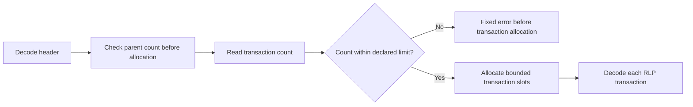

# Native Block.Decode transaction-count bound

Authority: System51 platform #635, parent #564, intake #629, release #49,
milestone7590180. Private baseline210df3a5dbd71cb47d3467f7f0a971dd3862bb01.
The admitted RC68 inputf07e084c06d758bc92377fc18cb5a0130fe6f89c contains
a preallocation transaction-count guard missing from the private baseline.

## Contract And Repair

Block.Decode reads a header, bounded parent count/parents, then transaction count.
The baseline allocates the transaction slice without checking that count.
Deserialize delegates to Decode; NewBlockFromBytes and serialized-block helpers
also reach this decoder. The existing DeserializeTxLoc and bounded serializer
already use the declared MaxTxPerBlock. This repair adds the same declared-limit
guard before allocation to Block.Decode. No constant, RLP encoding, header layout,
identifier hash, wire/storage version, eligibility or historical source changes.

MaxTxPerBlock currently equals104,858, derived from the existing1MiB block size
and nominal10-byte minimum transaction payload, plus1. That is a declared coarse
count ceiling, NOT a proof that104,858 actual Ethereum transactions fit in1MiB.
The repair does not strengthen actual total-byte or RLP-item size limits. Decode
can still partially mutate its receiver on malformed input; atomic decode is not
claimed. Other decoders, notably DeserializeTxLoc, need separate qualification.

## Evidence And Boundaries

An old-source overlay fails only the new count-bound contract: MaxTxPerBlock+1
allocates104,859 slots, then reaches EOF. The baseline test stops at this bounded
sentinel before any attacker-sized count can reach the old allocator. Maximum
uint64 refusal runs only after the fixed guard passes that first sentinel.

Tests retain empty/small complete real-RLP byte/header/transaction identity for
0,1,2 and16 transactions; these are unsigned synthetic codec fixtures, NOT
chain-valid transactions or blocks. Missing RLP at counts1 and the declared
limit retains EOF behavior; parent-limit and every truncated header/count input
are refused. The declared-limit truncation test allocates about0.8MiB of pointer
slots, not a complete maximum-sized transaction population.

Only newly written pure decoder and PoW/SCRYPT tests are materialized; no historical
peer-renewal/native-storage action, node startup, production data or peer connection
is used. Ordinary/race tests and actual bdag/nodeworker builds must qualify exact
candidate source. Private draft/source-byte/proof readback is not independent
CODEOWNER or protected accepted-source approval, a full Core suite, populated
storage recovery, fresh Sonar, live exploitability or network-release clearance.

Keep #635 open pending the remaining accepted-source/review gates. Continue other
safe private work without a routine executive approval stop.
