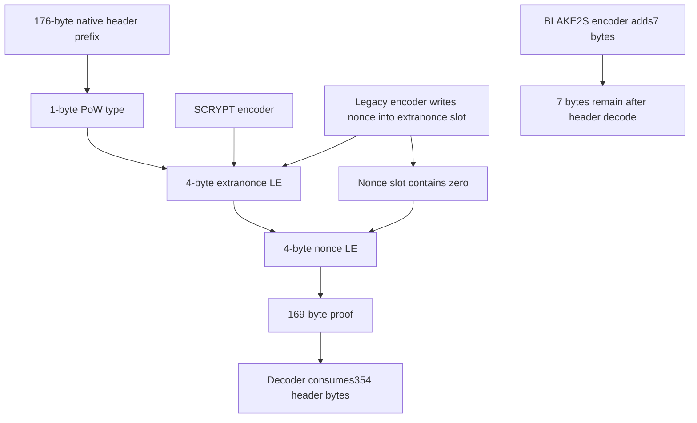

# Native PoW wire compatibility contract

Authority: System51 platform #624, parent #564, intake #629, release #49;
milestone7590180. Input-bound remediation #634 is deliberately separate.
Private archaeology baseline da8131bf360e59224d7254088ac9846cf0675314.
This document describes measured source/library behavior, NOT network clearance.

## Verified Current Formats

The header prefix is176 bytes. The decoder then reads exactly178 PoW bytes:
one type byte, four little-endian extranonce bytes, four little-endian nonce
bytes and169 proof bytes. Stable and mining-submit header codecs share this
layout. Header.BlockData produces185 bytes and BlockHash uses DoubleHashHEVM
over those bytes; that identifier is not the SCRYPT verification hash.

| Declared IDs | Factory behavior | Encoder / decoder result |
| --- | --- | --- |
| 10 SCRYPT | Scrypt |178 bytes; extranonce, nonce and proof preserved |
| 0 BLAKE2BD,6 KECCAK,7 CRYPTONIGHT,8 XKECCAK | Dedicated implementations |178 bytes; input nonce becomes decoded extranonce, decoded nonce is0; original extranonce is lost |
| 1 CUCKAROO,2 CUCKATOO,3 CUCKAROOM,4 X16RV3,5 X8R16 | Blake2bd fallback with requested ID retained | Declared names are NOT registered implementations; same legacy layout |
| 9 BLAKE2S | Blake2s |185 bytes; decoded extranonce0, decoded nonce equals input nonce shifted left8 bits modulo2^32, shifted proof,7 trailing bytes |

Unknown IDs11,127,255 are refused by the decoder, although the direct factory
also defaults for unknown IDs. A map name or successful factory call is not
proof of algorithm implementation or eligibility. PowConfig.Check validates
names and percentage totals, not factory registration or codec compatibility.

For nonzero legacy/BLAKE2S nonce, the actual decoded header hash differs.
Zero nonce may preserve the header hash while losing supplied extranonce or
proof/byte identity. Therefore hash equality alone is not full record identity.
BLAKE2S serializes361 header bytes while SerializeSize reports354.

## Configuration And Genesis

Current source selection in services/common/load.go SetupConfig accepts mainnet,
mainnet-isolated, testnet, privnet, devnet and mixnet. BDAG_NETWORK selects the
mode; flags provide the fallback selections. ActiveNetParams defaults to mainnet.
These are selectable source configurations, not observations of deployed flags.

Runtime library tests query each current mode's real PowConfig across heights
0,1,49,50,51,99,100,101 and maximum uint32, for all11 IDs. Mainnet,
mainnet-isolated, testnet, privnet and devnet declare SCRYPT100%. Mixnet declares
XKECCAK100% despite its incompatible nonzero-nonce legacy codec. Thus the
XKECCAK finding is NOT merely dormant code. All six current genesis headers use
SCRYPT and preserve serialization/hash identity; the mixnet declaration/genesis
distinction is recorded, not silently reinterpreted as a consensus violation.
Genesis eligibility/exemptions and real network use need their own evidence.

core/blockchain/validate.go checkBlockHeaderSanity checks configured eligibility;
checkProofOfWork normally calls header.Pow.Verify(header.BlockData(), ...).
BFNoPoWCheck and develop-difficulty configuration bypass that verification.
No verification bypass was enabled or node launched by this qualification.

## Historical Source Boundary

All twelve fixed #564 source inputs plus upstream developa2c29ab and correction
77d5c22 were compared to the private baseline using Go parser/AST normalized
declaration fingerprints, not comment-sensitive diffs or branch names. The
encoders, factory, decoder, header hash/BlockData and header codec declarations
are identical across these14 comparisons. SCRYPT C/H primitive bytes also match.
This is bounded source equivalence, NOT a complete historical-runtime or consensus
equivalence proof. Historical checkouts were not imported or executed.

Ten profiles have other admitted Go declaration differences: mainnet canonical
EVM checkpoint fields/values and, in the RC68 input, Block.Decode's transaction
allocation bound. Those differences must not be mislabeled nonce variants or
discarded by wholesale upstream overwrite. The private checkpoint controls are
retained. RC68's additional transaction-count guard is tracked as a separate
follow-up; it is not included in #634's one-line input-bound repair.

The machine ledger stores every exact source commit, blob, source SHA256 and
normalized declaration fingerprint. Historical codec parity does not prove
all external import/export helpers or persisted formats have been inventoried.

## Measured Qualification

The new TestNativePowWireMatrix exercises11 types x8 extranonces x8 nonces x2
proof patterns =1,408 combinations. All128 SCRYPT combinations preserve fields,
proof, bytes, header data and actual header hash. Other layouts are deliberately
characterized as defects, not waived as supported. Decoder tests refuse every
truncated length0..177, refuse three unknown IDs and preserve reader composition.
The six-mode/genesis tests and this matrix pass with race instrumentation too.

An external pure-library overlay reproduces panics for all32 SCRYPT Verify input
lengths153..184. The old guard checks153 but the nonce access requires185.
The current normal caller supplies185 bytes, so network exploitability is unproved.
The #634 contract test fails on that old source and complete-input controls pass.
#634 changes only the guard to185, retaining all offsets, hash reconstruction,
difficulty checks, formats and eligibility. It must separately qualify all185
short lengths and240 complete-input/difficulty/argument controls on exact source.

No historical peer-renewal/native-storage fixture, peer connection, production
data, mining deployment, NUC or X100 operation is part of these tests. Passing
characterization of a known defect is NOT a green full-stack release gate.

## Compatibility And Release Rules

- Require exact field, proof, byte-consumption and header-hash identity before
  treating a serialized record as the requested canonical record.
- Use the measured SCRYPT layout for current private qualification fixtures;
  do not change native production format or activate an algorithm based on this
  archaeology document. Existing mainnet configuration remains unchanged.
- Do not certify mixnet/XKECCAK, BLAKE2S or fallback IDs for nonzero-nonce
  persisted round trips. Keep those mode/format gaps explicit in release evidence.
- Never silently normalize legacy nonce bytes: that changes identifiers/history.
  An eventual fix needs versioned format/import rules, exact real-history inventory,
  dual-decoder ambiguity/refusal analysis, storage and consensus regression proof,
  reviewed migration/rollback and appropriate eventual cutover approval.
- Incomplete or ambiguous historical provenance remains unknown, not inferred
  from zero nonce, a matching name, synthetic fixtures or comment assertions.
- Keep #624 open pending full helper/caller/storage compatibility coverage,
  source-bound CI integration and reviewed accepted-source/protected gates.
  Private draft PRs and local qualification do not satisfy those gates.

Continue independent safe work while these specific release findings remain open.
No public/production/paid/upstream or destructive action is authorized here.
