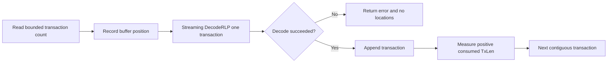

# Native transaction-location decoding contract

Authority: System51 platform #636, parent #564/#624, intake #629, release #49,
milestone7590180. Private baselinecb4c5ca6354271fc0237f8b69a6f223f2893434e.
Scope: Block.DeserializeTxLoc and public SerializedBlock.TxLoc in core/types/block.go.

## Reproduced Defect And Repair

The serializer writes each transaction using Transaction.EncodeRLP. The old helper
instead calls UnmarshalBinary on ALL remaining bytes, ignores its error and never
consumes the bytes.Buffer. It reports zero-length locations, leaves payload unread,
and can append a transaction despite malformed/truncated input. UnmarshalBinary's
canonical typed envelope is not the block stream's RLP-wrapped envelope.

The new helper uses the existing normal Block.Decode pattern: create an RLP stream,
DecodeRLP exactly one transaction, return any error, append only a decoded transaction,
measure actual consumed bytes. Existing parent/transaction ceilings, valid serialized
bytes, header/transaction identifiers, consensus eligibility and source history remain
unchanged. Invalid input previously accepted by ignoring errors is now refused.

## Exact Source / Library Evidence

An old-source test overlay fails precisely complete-record consumption, malformed
input refusal and reader composition. Existing count and PoW/SCRYPT contracts pass.
New tiny fixtures cover the four types actually implemented by the vendored decoder:
legacy0, access-list1, dynamic-fee2 and blob3, individually and in mixed blocks.
Set-code/type4 is not implemented in this vendored source and remains an unsupported
input control. These are unsigned codec fixtures; no blob sidecar, KZG proof,
signature, chain validity or external Ethereum version support is claimed.

Required tests verify exact full consumption and header/transaction identity,
positive contiguous locations covering the complete transaction payload, individual
wire-slice identity, public TxLoc adapter, retained trailing reader byte, every
truncation of a small two-transaction block, malformed/unsupported RLP refusal,
and unchanged parent/count preallocation bounds. Existing #635 decoder and #624/#634
PoW/SCRYPT tests remain required. No historical peer-renewal/native-storage action
or historical test body is materialized or executed by isolated qualification.

The public SerializedBlock.TxLoc adapter is exercised directly. A bounded admitted
compiler-view search found no other in-tree .TxLoc call in core/database/node/services;
that search is NOT a complete semantic call graph or inventory of external consumers.
No production indexing corruption/exploitability is inferred from library fixtures.
Failed decode may still partially mutate a receiver: callers must discard failed
results. This patch is not atomic decode or an RLP-item/total-byte budget guarantee.

## Acceptance Boundary

Exact-source ordinary/race tests, real bdag/nodeworker builds, private draft/full
remote changed-source bytes and immutable complete evidence readback are required.
They are not a whole Core suite, real history/storage/network regression, fresh
Sonar, signed outer release, independent CODEOWNER or protected accepted-source
merge. Keep #636/#624/#564/#49 open pending those remaining gates. No production,
NUC/X100/chain peer, public, paid, upstream, raw secret or destructive action.
Continue other ready private lanes without routine executive approval stops.
